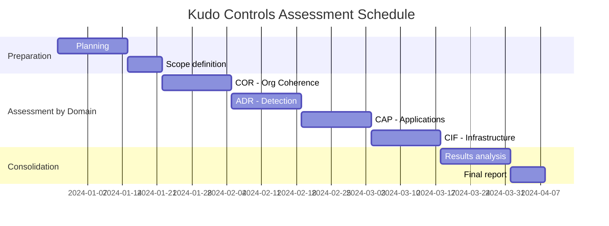

## Purpose

Establish a systematic approach to assess the effectiveness of the security controls defined in the Kudo domains, ensuring they meet the established security objectives.

## Assessment Plan Structure

### 1. Plan Metadata
- **Version**: v1.0.0
- **Creation date**: Current date
- **Owner**: DivisionCero's CISO
- **Frequency**: Annual with quarterly reviews

### 2. Assessment Scope

#### Kudo Domains to Assess:
- **COR**: Organizational Coherence
- **ADR**: Cybersecurity Analysis, Detection and Response
- **CAP**: Application Cybersecurity
- **CCN**: Business Continuity and Change
- **CIF**: Infrastructure Cybersecurity
- **CIP**: Identity and Endpoint Cybersecurity
- **DIA**: Data and Artificial Intelligence Cybersecurity
- **THP**: Human Talent and Vendor Cybersecurity

### 3. Assessment Methodology

#### Assessment Types:
1. **Document Assessment**: Review of policies and procedures
2. **Technical Assessment**: Automated and manual testing
3. **Operational Assessment**: Observation of processes in operation
4. **Interviews**: With staff responsible for controls

#### Assessment Criteria:
- **Effective**: Control implemented and working as designed
- **Partially Effective**: Control implemented with minor deficiencies
- **Not Effective**: Control not implemented or with critical deficiencies

### 4. Assessment Schedule

### 5. Required Resources

#### Assessment Team:
- **Assessment Lead**: CISO
- **Technical Assessors**: IT Security Team
- **Process Assessors**: Internal Auditors
- **Domain Specialists**: According to the domain assessed

#### Tools:
- Vulnerability scanning tools
- Monitoring and logging systems
- Document management platforms
- Configuration analysis tools

### 6. Expected Deliverables

1. **Assessment Results (AR)**: Detailed results by control
2. **Executive Summary**: Executive summary for management
3. **Plan of Action and Milestones (POA&M)**: Remediation plan
4. **Lessons Learned**: Lessons learned and improvements

### 7. Integration with Other Processes

- **Risk Management**: Updating the risk matrix
- **Continuous Monitoring**: Feeding continuous monitoring
- **Compliance**: Evidence for external audits
- **Incident Response**: Identifying response gaps

## Implementation at DivisionCero

This Assessment Plan runs as part of the continuous improvement cycle of DivisionCero's security posture, ensuring all Kudo controls remain effective over time.

---

*Document generated according to OSCAL standards for the Kudo framework v1.0*
