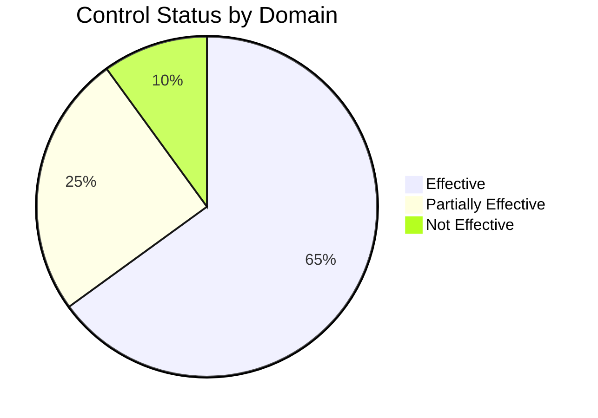

## Purpose

Provide a structured, traceable record of control assessment results, supporting informed decision-making about the organization's security posture.

## Assessment Results Structure

### 1. Results Metadata
- **Document Version**: v1.0.0
- **Assessment Date**: Execution period
- **Assessors**: Responsible team
- **Scope**: Domains and controls assessed
- **Methodology Applied**: Reference to the Assessment Plan

### 2. Executive Summary

#### Overall Status of Kudo Controls

#### Key Metrics:
- **Total controls assessed**: 150
- **Effective controls**: 98 (65%)
- **Partially effective controls**: 37 (25%)
- **Not effective controls**: 15 (10%)
- **Average maturity level**: 3.2/5.0

### 3. Results by Kudo Domain

#### COR - Organizational Coherence
| Control | Status | Level | Evidence | Notes |
|---------|--------|-------|-----------|---------------|
| COR-001 | ✅ Effective | 4/5 | Approved policy | Full implementation |
| COR-002 | ⚠️ Partial | 3/5 | Committee established | Frequency missing |
| COR-003 | ❌ Not Effective | 1/5 | No evidence | Requires implementation |

#### ADR - Analysis, Detection and Response
| Control | Status | Level | Evidence | Notes |
|---------|--------|-------|-----------|---------------|
| ADR-001 | ✅ Effective | 4/5 | SIEM operational | 24/7 monitoring active |
| ADR-002 | ✅ Effective | 5/5 | Response plan | Tested procedures |
| ADR-003 | ⚠️ Partial | 3/5 | Tools configured | Automation missing |

#### CAP - Application Cybersecurity
| Control | Status | Level | Evidence | Notes |
|---------|--------|-------|-----------|---------------|
| CAP-001 | ✅ Effective | 4/5 | SAST/DAST implemented | Integrated pipeline |
| CAP-002 | ⚠️ Partial | 2/5 | Ad-hoc reviews | Needs systematization |
| CAP-003 | ✅ Effective | 4/5 | Valid certificates | Automated management |

### 4. Critical Findings

#### Strengths Identified:
1. **Monitoring and Detection**: Fully operational SIEM with advanced correlation
2. **Identity Management**: Robust implementation of MFA and PAM
3. **Business Continuity**: Tested, up-to-date recovery plans
4. **Encryption**: Consistent implementation for data in transit and at rest

#### Critical Weaknesses:
1. **Vulnerability Management**: Reactive patching process
2. **Training**: Inconsistent awareness program
3. **Third-Party Management**: Limited vendor assessment
4. **Incident Response**: Lack of regular exercises

### 5. Residual Risk Analysis

#### High-Impact Risks:
- **Data Breach**: Medium (partial controls in DIA)
- **Service Disruption**: Low (effective controls in CCN)
- **Insider Threat**: High (gaps in THP)
- **Supply Chain Attack**: Medium (limited third-party assessment)

### 6. Evidence and Artifacts

#### Documentation Reviewed:
- 85 Kudo policies and procedures
- System configuration records
- Audit and monitoring logs
- Vulnerability scanning reports

#### Tests Performed:
- Internal penetration tests
- Phishing simulations
- Incident response exercises
- Backup and recovery validation

### 7. Prioritized Recommendations

#### Short Term (1-3 months):
1. Implement an automated patch management process
2. Establish a formal security training program
3. Complete implementation of missing COR controls
4. Improve automation in event correlation

#### Medium Term (3-6 months):
1. Develop a third-party assessment program
2. Implement regular incident response exercises
3. Strengthen privileged access controls
4. Establish automated security metrics

#### Long Term (6-12 months):
1. Implement a threat hunting program
2. Develop predictive security capabilities
3. Establish a security operations center (SOC)
4. Complete ISO 27001 certification

### 8. Follow-up Plan

#### Continuous Monitoring:
- Real-time security metrics dashboard
- Quarterly control status reviews
- Automatic alerts for control degradation
- Monthly reports to senior management

#### Upcoming Assessments:
- **Incremental assessment**: Quarterly
- **Full assessment**: Annual
- **Special assessments**: Upon significant changes

## Conclusions

The assessment revealed a solid security posture with specific opportunities for improvement. The Kudo framework provides a robust foundation, but requires attention in specific areas to reach the target maturity level.

### Maturity Level by Domain:
- **COR**: 3.5/5.0 - Mature
- **ADR**: 4.2/5.0 - Advanced  
- **CAP**: 3.8/5.0 - Mature
- **CCN**: 4.0/5.0 - Advanced
- **CIF**: 3.2/5.0 - Developing
- **CIP**: 3.9/5.0 - Mature
- **DIA**: 2.8/5.0 - Developing
- **THP**: 2.5/5.0 - Basic

---

*Document generated according to OSCAL standards for the Kudo framework v1.0*  
*Next scheduled assessment: [Date + 1 year]*
