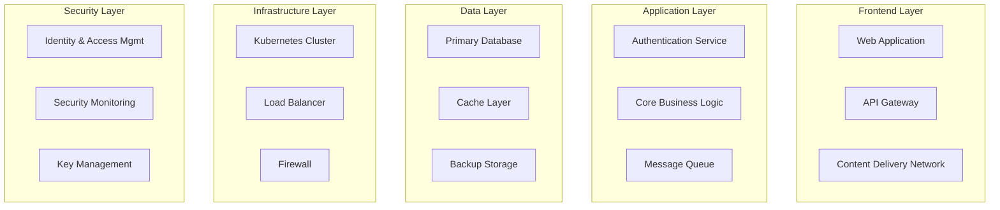

## Purpose

Document the specific implementation of security controls in each system component, supporting traceability between abstract controls and their technical realization.

## DivisionCero System Architecture

### High-Level View

## Components and Implementations

### 1. Web Application Component

**Description**: Frontend application built with Next.js  
**Responsibility**: User interface and customer experience  
**Technology**: Next.js 15.4.2 + React 19.1.0

#### Implemented Controls:

**CAP-001: Secure Development**
- **Implementation**: 
  - Content Security Policy (CSP) configured
  - Input validation through Zod schemas
  - XSS protection enabled
  - HTTPS enforcement
- **Evidence**: 
  - `next.config.js` with security headers
  - Form validation with sanitization
  - Automated dependency audits

**CIP-001: Identity Management**
- **Implementation**:
  - NextAuth.js for authentication
  - OAuth 2.0 with external providers
  - Secure session management
  - JWT with token rotation
- **Evidence**:
  - Multi-provider authentication configuration
  - Tokens with configured expiration
  - Secure logout implemented

### 2. API Gateway Component

**Description**: API gateway implemented with Kong  
**Responsibility**: Routing, authentication and rate limiting  
**Technology**: Kong Gateway + OAuth 2.0

#### Implemented Controls:

**CAP-002: API Management**
- **Implementation**:
  - Rate limiting per client/endpoint
  - API key authentication
  - Request/response transformation
  - Logging of all transactions
- **Evidence**:
  - Rate limiting policy configuration
  - API access logs
  - OpenAPI 3.0 documentation

**ADR-001: Continuous Monitoring**
- **Implementation**:
  - Exported performance metrics
  - Alerts on traffic anomalies
  - Centralized logs in the ELK Stack
- **Evidence**:
  - Configured Grafana dashboard
  - Alerts in Prometheus
  - Event correlation in the SIEM

### 3. Core Business Logic Component

**Description**: Main business logic  
**Responsibility**: Transaction processing and business rules  
**Technology**: Node.js + TypeScript + Prisma

#### Implemented Controls:

**DIA-001: Data Classification**
- **Implementation**:
  - Schemas with classification labels
  - Data separated by sensitivity
  - Classification-based access
- **Evidence**:
  - Data models with metadata
  - Queries with classification filters
  - Audit trails by data type

**DIA-002: Data Encryption**
- **Implementation**:
  - Encryption in transit (TLS 1.3)
  - Encryption at rest (AES-256)
  - Automated key rotation
- **Evidence**:
  - Valid TLS certificates
  - Database encryption configuration
  - Key rotation logs

### 4. Database Component

**Description**: Main PostgreSQL database  
**Responsibility**: Data persistence  
**Technology**: PostgreSQL 15 + pgcrypto

#### Implemented Controls:

**CIF-001: System Hardening**
- **Implementation**:
  - Configuration according to the CIS Benchmark
  - Minimal users and permissions
  - Access auditing enabled
- **Evidence**:
  - postgresql.conf configuration
  - Documented roles and permissions
  - Configured audit logs

**CCN-001: Continuity Plan**
- **Implementation**:
  - Master-slave replication
  - Automatic daily backups
  - Point-in-time recovery (PITR)
- **Evidence**:
  - Automated backup scripts
  - Documented restore tests
  - Defined and tested RTO/RPO

### 5. Kubernetes Cluster Component

**Description**: Container orchestrator  
**Responsibility**: Service deployment and management  
**Technology**: Kubernetes 1.28 + Helm

#### Implemented Controls:

**CIF-002: Patch Management**
- **Implementation**:
  - Automated patching with Argo CD
  - Image vulnerability scanning
  - Rolling updates without downtime
- **Evidence**:
  - Automatic update pipeline
  - Trivy scanner reports
  - Deployment history

**CIP-002: Endpoint Protection**
- **Implementation**:
  - Network Policies configured
  - Pod Security Standards enforced
  - Runtime security with Falco
- **Evidence**:
  - Documented network policies
  - Configured Falco alerts
  - Defined security contexts

### 6. SIEM Component

**Description**: Security Information and Event Management  
**Responsibility**: Correlation and analysis of security events  
**Technology**: Elastic Stack (ELK) + Wazuh

#### Implemented Controls:

**ADR-001: Continuous Monitoring**
- **Implementation**:
  - Log ingestion from all components
  - Automated event correlation
  - Real-time dashboards
  - Alerts through ML anomaly detection
- **Evidence**:
  - Logstash pipeline configuration
  - Correlation rules in Wazuh
  - 24/7 operational dashboard

**ADR-002: Incident Response Plan**
- **Implementation**:
  - Automated playbooks
  - Automatic alert escalation
  - Forensics capabilities
- **Evidence**:
  - SOAR integration configured
  - Escalation procedures
  - Forensic tools available

### 7. IAM Component

**Description**: Identity and Access Management  
**Responsibility**: Authentication and authorization  
**Technology**: Keycloak + LDAP

#### Implemented Controls:

**CIP-001: Identity Management**
- **Implementation**:
  - Corporate Single Sign-On (SSO)
  - Multi-Factor Authentication (MFA)
  - Role-Based Access Control (RBAC)
  - Automated provisioning/deprovisioning
- **Evidence**:
  - MFA policy configuration
  - Documented RBAC matrices
  - Automatic provisioning scripts

**THP-001: Security Training**
- **Implementation**:
  - Training completion tracking
  - Conditional access based on training
  - Compliance reports per user
- **Evidence**:
  - LMS integration configured
  - Conditional access policies
  - Compliance dashboards

## Traceability Matrix

### Controls vs. Components

| Control | Web App | API GW | Core Logic | Database | K8s | SIEM | IAM |
|---------|---------|--------|------------|----------|-----|------|-----|
| COR-001 | ➖ | ➖ | ✅ | ➖ | ➖ | ✅ | ✅ |
| ADR-001 | ⚠️ | ✅ | ⚠️ | ⚠️ | ⚠️ | ✅ | ⚠️ |
| ADR-002 | ➖ | ⚠️ | ➖ | ➖ | ➖ | ✅ | ➖ |
| CAP-001 | ✅ | ➖ | ✅ | ➖ | ⚠️ | ➖ | ➖ |
| CAP-002 | ➖ | ✅ | ➖ | ➖ | ➖ | ⚠️ | ➖ |
| CCN-001 | ➖ | ➖ | ➖ | ✅ | ✅ | ➖ | ➖ |
| CIF-001 | ➖ | ⚠️ | ➖ | ✅ | ✅ | ⚠️ | ⚠️ |
| CIF-002 | ⚠️ | ⚠️ | ⚠️ | ⚠️ | ✅ | ➖ | ⚠️ |
| CIP-001 | ✅ | ⚠️ | ➖ | ➖ | ➖ | ➖ | ✅ |
| CIP-002 | ⚠️ | ➖ | ➖ | ➖ | ✅ | ⚠️ | ➖ |
| DIA-001 | ➖ | ➖ | ✅ | ⚠️ | ➖ | ➖ | ➖ |
| DIA-002 | ⚠️ | ⚠️ | ✅ | ✅ | ⚠️ | ➖ | ➖ |
| THP-001 | ➖ | ➖ | ➖ | ➖ | ➖ | ➖ | ✅ |

**Legend**:  
✅ = Fully implemented  
⚠️ = Partially implemented  
➖ = Not applicable/Not implemented

## Dependencies and Integrations

### External Dependencies
- **OAuth Providers**: Google, Microsoft, GitHub
- **Certificate Authority**: Let's Encrypt + Internal PKI
- **DNS Provider**: Cloudflare
- **Monitoring**: Datadog APM

### Security Integrations
- **Vulnerability Scanners**: Snyk, Trivy
- **SAST/DAST**: SonarQube, OWASP ZAP
- **Secret Management**: HashiCorp Vault
- **Backup Services**: AWS S3 + Glacier

## Configuration Management

### Configuration as Code
- **Infrastructure**: Terraform + Ansible
- **Applications**: Helm Charts + Kustomize  
- **Security Policies**: Open Policy Agent (OPA)
- **CI/CD**: GitLab CI/CD + ArgoCD

### Change Management
- **Git Flow**: Feature branches with security reviews
- **Approval Process**: Automated + manual gates
- **Rollback Strategy**: Automated rollback triggers
- **Testing**: Security tests in staging

## Metrics and Monitoring

### Security KPIs by Component
- **Availability**: 99.9% uptime SLA
- **Performance**: p95 < 200ms response time
- **Security**: 0 critical vulnerabilities in production
- **Compliance**: 100% of critical controls implemented

### Critical Alerts
- **Security incidents**: Automatic detection + escalation
- **Performance degradation**: Auto-scaling triggers
- **Compliance violations**: Immediate alerts to the CISO

---

*Kudo Component Definition v1.0 - Document generated according to OSCAL standards*  
*System: DivisionCero Platform | Last updated: 2024*
