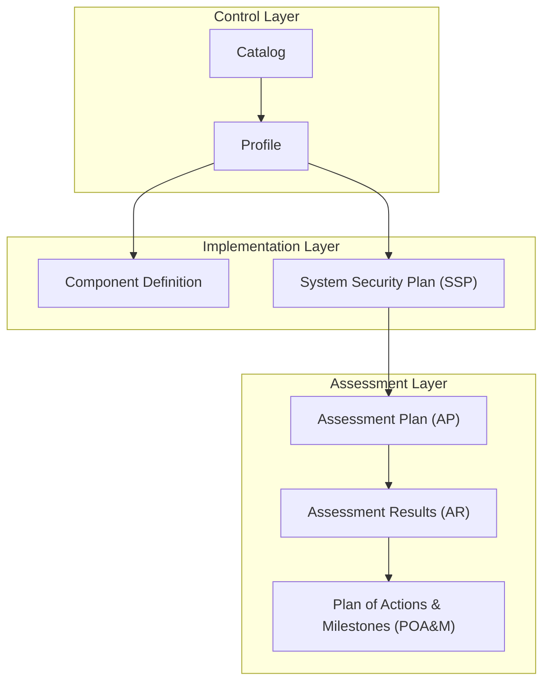

import { Database, Settings2, Boxes, ShieldCheck, ClipboardList, ClipboardCheck, ListChecks } from 'lucide-react';
import { Accordion, Accordions } from 'fumadocs-ui/components/accordion';

## Kudo Framework

| Element      | Count    |
| ------------ | -------- |
| Domains      | 8        |
| Controls     | 35       |
| Requirements | 491      |

## What is OSCAL?

OSCAL (Open Security Controls Assessment Language) is a set of formats developed by NIST (National Institute of Standards and Technology) that standardizes how information about information system security controls is expressed, assessed and exchanged.

## OSCAL formats

OSCAL supports three formats: **json**, **xml** and **yaml**.

With Kudo we also generate an export in: **toon**.

## Kudo-OSCAL integration

The Kudo framework is designed to be compatible with OSCAL, providing a practical implementation of security controls expressed in the 7 main components of the OSCAL model:

<Cards>
  <Card href="/en/kudo/framework/oscal/catalog" icon={<Database />} title="Catalog">
    Catalog of the Kudo framework's security controls structured according to the OSCAL model
  </Card>
  <Card href="/en/kudo/framework/oscal/profile" icon={<Settings2 />} title="Profile">
    Implementation profile that defines the specific selection and configuration of Kudo controls
  </Card>
  <Card href="/en/kudo/framework/oscal/component-definition" icon={<Boxes />} title="Component Definition">
    Definition of system components and their control implementations according to the OSCAL model
  </Card>
  <Card href="/en/kudo/framework/oscal/ssp-system-security-plan" icon={<ShieldCheck />} title="System Security Plan (SSP)">
    Comprehensive system security plan documenting the implementation of controls according to the Kudo framework
  </Card>
  <Card href="/en/kudo/framework/oscal/ap-assessment-plan" icon={<ClipboardList />} title="Assessment Plan (AP)">
    OSCAL-based security control assessment plan to validate the implementation of Kudo controls
  </Card>
  <Card href="/en/kudo/framework/oscal/ar-assessment-results" icon={<ClipboardCheck />} title="Assessment Results (AR)">
    Results of the Kudo security control assessment documented according to OSCAL standards
  </Card>
  <Card href="/en/kudo/framework/oscal/poam-plan-of-actions-and-milestones" icon={<ListChecks />} title="Plan of Actions & Milestones (POA&M)">
    Corrective action plan and schedule to remediate deficiencies identified in security controls
  </Card>
</Cards>

## Reference

Adapting Kudo to OSCAL is a collaborative project. To contribute:

1. Check our [GitHub repository](https://github.com/PetterVargas/divisioncero.com/tree/main/content/kudo/framework/oscal)
2. Review [NIST's OSCAL standards](https://pages.nist.gov/OSCAL/)
