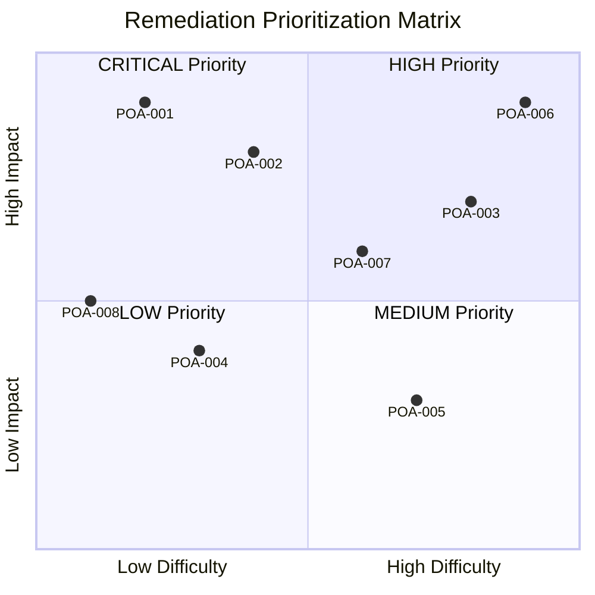
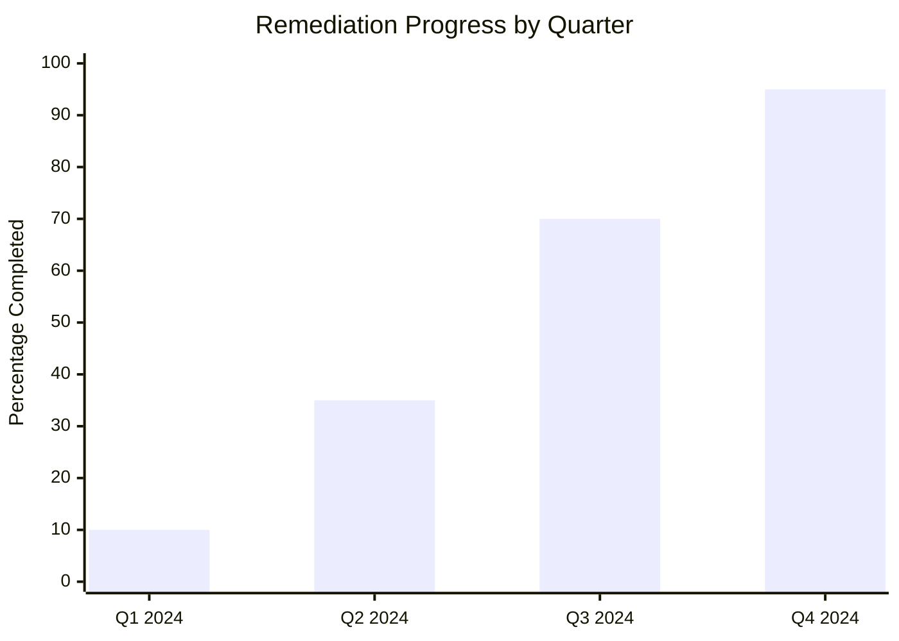

## Purpose

Provide a systematic framework to track, prioritize and remediate identified security deficiencies, ensuring the continuous improvement of the organization's security posture.

## Prioritization Methodology

### Risk Matrix

## Identified Deficiencies and Remediation Plan

### POA-001: Automated Vulnerability Management [CRITICAL]

**Affected Control**: CIF-002 - Patch Management  
**Domain**: Cloud Cybersecurity  
**Current Status**: Not Effective  

**Deficiency Description**:
The current patch management process is reactive and manual, creating prolonged exposure windows for critical vulnerabilities.

**Security Impact**:
- **High**: Exposure to exploitation of known vulnerabilities
- **CVSS Base**: 8.5 (High)
- **Affected Systems**: 85% of the infrastructure

**Action Plan**:
1. **Tool evaluation** (Weeks 1-2)
   - Analysis of Qualys VMDR vs. Rapid7 InsightVM
   - POC with 10% of pilot systems
   - Definition of automation criteria

2. **Solution implementation** (Weeks 3-8)
   - Agent deployment on critical infrastructure
   - Configuration of automated patching policies
   - SIEM integration for alerts

3. **Operationalization** (Weeks 9-12)
   - Training for the operations team
   - Runbook documentation
   - Establishment of remediation SLAs

**Owner**: Infrastructure Team  
**Commitment Date**: 12 weeks from approval  
**Estimated Budget**: $125,000 USD  
**Required Resources**: 2 FTE + external consulting  

**Milestones**:
- ✅ **M1**: Budget approval (Week 0)
- 🔄 **M2**: Tool selection (Week 2)
- ⏳ **M3**: Pilot implementation (Week 4)
- ⏳ **M4**: Production rollout (Week 8)
- ⏳ **M5**: Full operationalization (Week 12)

---

### POA-002: Security Training Program [CRITICAL]

**Affected Control**: THP-001 - Security Training  
**Domain**: Human Talent and Vendor Cybersecurity  
**Current Status**: Partially Effective  

**Deficiency Description**:
Lack of a structured, measurable cybersecurity training program covering all employees with up-to-date content.

**Security Impact**:
- **High**: The human factor as the main attack vector
- **Statistic**: 95% of successful attacks involve human error
- **Affected Staff**: 180 employees without up-to-date training

**Action Plan**:
1. **Program design** (Weeks 1-4)
   - Evaluation of LMS platforms (KnowBe4, Proofpoint)
   - Development of role-specific content
   - Definition of metrics and KPIs

2. **Implementation** (Weeks 5-8)
   - LMS platform configuration
   - Creation of tracks by department
   - Integration with the HR system

3. **Launch and follow-up** (Weeks 9-16)
   - Corporate launch campaign
   - Monthly phishing simulations
   - Completion rate reports

**Owner**: CISO + HR  
**Commitment Date**: 16 weeks from approval  
**Estimated Budget**: $80,000 USD/year  
**Required Resources**: 1 FTE + content contractor  

**Milestones**:
- ⏳ **M1**: LMS selection (Week 2)
- ⏳ **M2**: Content developed (Week 6)  
- ⏳ **M3**: Pilot with 20% of staff (Week 10)
- ⏳ **M4**: Full rollout (Week 16)

---

### POA-003: Third-Party Risk Assessment [HIGH]

**Affected Control**: THP-002 - Third-Party Assessment  
**Domain**: Human Talent and Vendor Cybersecurity  
**Current Status**: Not Effective  

**Deficiency Description**:
No formal process to assess and manage the cybersecurity risks of critical vendors.

**Security Impact**:
- **Medium-High**: Exposure to supply chain risks
- **Critical Vendors**: 25 without a security assessment
- **Data Access**: 80% have access to sensitive information

**Action Plan**:
1. **Assessment framework** (Weeks 1-6)
   - Development of a customized SIG Lite questionnaire
   - Definition of risk acceptance criteria
   - Creation of a due diligence process

2. **Assessment of existing vendors** (Weeks 7-20)
   - Sending questionnaires to 25 critical vendors
   - Response analysis and scoring
   - Remediation plans per vendor

3. **Operationalization** (Weeks 21-24)
   - Integration with the purchasing process
   - Training for procurement teams
   - Third-party risk dashboard

**Owner**: CISO + Procurement  
**Commitment Date**: 24 weeks from approval  
**Estimated Budget**: $60,000 USD  
**Required Resources**: 1.5 FTE + vendor risk management tool  

---

### POA-004: Incident Response Improvement [MEDIUM]

**Affected Control**: ADR-002 - Incident Response Plan  
**Domain**: Analysis, Detection and Response  
**Current Status**: Partially Effective  

**Deficiency Description**:
Documented response plan, but no regular exercises and no escalation automation.

**Action Plan**:
1. **Runbook update** (Weeks 1-4)
2. **Quarterly drills** (Ongoing)
3. **Escalation automation** (Weeks 5-12)

**Owner**: SOC Manager  
**Commitment Date**: 12 weeks  
**Estimated Budget**: $35,000 USD  

---

### POA-005: Formal Data Classification [MEDIUM]

**Affected Control**: DIA-001 - Data Classification
**Domain**: Data and Artificial Intelligence Cybersecurity
**Current Status**: Partially Effective  

**Deficiency Description**:
Informal classification system with no automated enforcement tools.

**Action Plan**:
1. **Formal scheme definition** (Weeks 1-3)
2. **DLP implementation** (Weeks 4-12)  
3. **Data discovery and labeling** (Weeks 13-20)

**Owner**: Data Protection Officer  
**Commitment Date**: 20 weeks  
**Estimated Budget**: $95,000 USD  

## Tracking Dashboard

### Overall POA&M Status

| ID | Control | Priority | Status | Progress | Due Date | Owner |
|----|---------|-----------|--------|----------|----------|-------|
| POA-001 | CIF-002 | 🔴 CRITICAL | 🔄 In Progress | 15% | 2024-06-15 | Infra Team |
| POA-002 | THP-001 | 🔴 CRITICAL | ⏳ Pending | 0% | 2024-07-30 | CISO |
| POA-003 | THP-002 | 🟡 HIGH | ⏳ Pending | 0% | 2024-09-15 | Procurement |
| POA-004 | ADR-002 | 🟢 MEDIUM | 🔄 In Progress | 40% | 2024-05-30 | SOC |
| POA-005 | DIA-001 | 🟢 MEDIUM | ⏳ Pending | 0% | 2024-08-30 | DPO |

### Performance Metrics

### Investment by Domain

| Domain | Investment USD | % of Total | Estimated ROI |
|---------|---------------|-------------|--------------|
| CIF | $125,000 | 31% | High |
| THP | $140,000 | 35% | Very High |
| ADR | $35,000 | 9% | Medium |
| DIA | $95,000 | 24% | High |
| **Total** | **$395,000** | **100%** | **High** |

## Governance and Reporting

### Oversight Committee
- **Chair**: CISO  
- **Members**: CTO, CFO, Head of Engineering, Head of Operations
- **Frequency**: Biweekly meetings
- **Escalation**: Board level for critical risks

### Executive Reports
- **Frequency**: Monthly
- **Audience**: C-Level + Board
- **Key Metrics**:
  - % of remediations completed on time
  - Residual risk reduction
  - ROI of security investments

### Closure Criteria
A deficiency is considered closed when:
1. The control is implemented and operational
2. Evidence of effectiveness is documented  
3. It's validated by an independent assessor
4. The System Security Plan is updated

## Continuous Monitoring

### Automatic Alerts
- **Schedule deviations**: > 10% delay
- **Budget escalation**: > 15% overrun  
- **Emerging risks**: New critical vulnerabilities

### Review and Update
- **Frequency**: Monthly
- **Update triggers**:
  - New assessment findings
  - Changes in the threat landscape
  - Changes in business priorities

---

*Kudo POA&M v1.0 - Document generated according to OSCAL standards*  
*Last updated: 2024 | Next review: March 2024*
