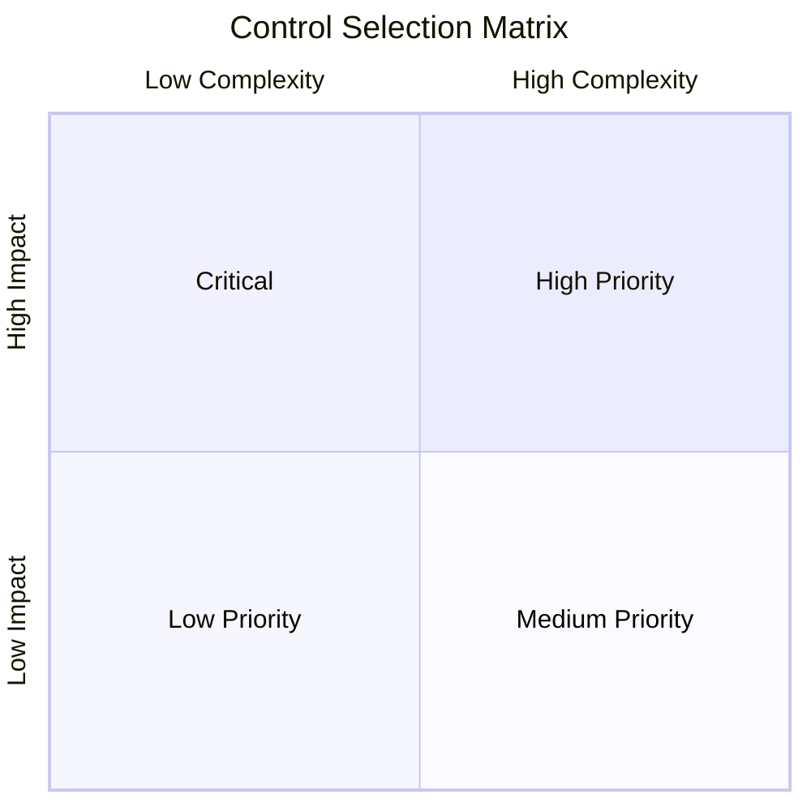
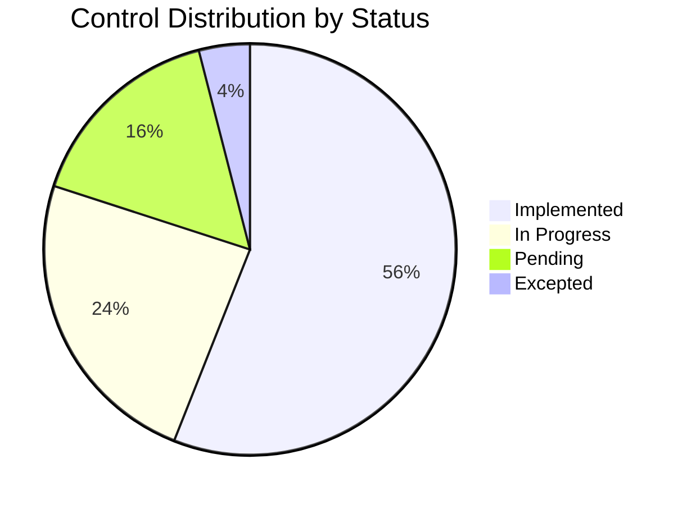

## Purpose

Establish a customized subset of Kudo controls with specific configurations that reflect DivisionCero's risk appetite, available resources and operational context.

## Profile Information

### Metadata
- **Name**: DivisionCero Security Profile v1.0
- **Based on**: Kudo Catalog v1.0.0
- **Context**: SaaS company, ~200 employees, multi-tenant
- **Sector**: Technology / Software Development
- **Applicable regulations**: GDPR, SOC 2 Type II
- **Effective date**: 2024-01-01
- **Next review**: 2024-12-31

## Selection Criteria

### Prioritization Factors
1. **Business criticality**: Impact on core operations
2. **Risk exposure**: Likelihood and impact of materialization
3. **Compliance requirements**: Regulatory obligations
4. **Available resources**: Budget and specialized staff
5. **Organizational maturity**: Implementation capability

### Applicability Matrix

## Controls Selected by Domain

### COR - Organizational Coherence [CRITICAL]
**Implementation Level**: Complete (100% of controls)  
**Rationale**: Fundamental foundation for all other domains

#### Included Controls:
- ✅ **COR-001**: Cybersecurity Governance
  - **Parameter**: Monthly executive committee
  - **Customization**: Include CEO, CTO, CISO, CFO
  
- ✅ **COR-002**: Security Framework Policy
  - **Parameter**: Mandatory annual review
  - **Customization**: Approval by the Board of Directors

- ✅ **COR-003**: Roles and Responsibilities Model
  - **Parameter**: RACI matrix updated quarterly
  - **Customization**: Specific roles for startup scaling

### ADR - Cybersecurity Analysis, Detection and Response [CRITICAL]
**Implementation Level**: High (90% of controls)  
**Rationale**: 24/7 protection is essential for a SaaS platform

#### Included Controls:
- ✅ **ADR-001**: Continuous Monitoring
  - **Parameter**: 99.9% SIEM uptime SLA
  - **Customization**: Machine learning enabled
  
- ✅ **ADR-002**: Incident Response Plan
  - **Parameter**: RTO 4 hours, RPO 1 hour
  - **Customization**: Automatic notification to customers

- ✅ **ADR-003**: Threat Intelligence
  - **Parameter**: Commercial + open source feeds
  - **Customization**: Focus on attacks against SaaS

#### Excluded Controls:
- ❌ **ADR-005**: Advanced Forensics
  - **Rationale**: Outsource to external specialists
  - **Review**: 2025, upon reaching 500+ employees

### CAP - Application Cybersecurity [CRITICAL]
**Implementation Level**: High (85% of controls)  
**Rationale**: The core business is software development

#### Included Controls:
- ✅ **CAP-001**: Secure Development
  - **Parameter**: SAST/DAST in 100% of pipelines
  - **Customization**: Automated security testing gates
  
- ✅ **CAP-002**: API Management
  - **Parameter**: Rate limiting 1000 req/min
  - **Customization**: OAuth 2.0 + API keys hybrid

- ✅ **CAP-003**: Secure Code Review
  - **Parameter**: 100% of PRs with security review
  - **Customization**: AI-assisted vulnerability detection

### CCN - Business Continuity and Change [HIGH]
**Implementation Level**: Medium (75% of controls)  
**Rationale**: Cloud-native with naturally high availability

#### Included Controls:
- ✅ **CCN-001**: Business Continuity Plan
  - **Parameter**: RTO 4 hours, RPO 1 hour
  - **Customization**: Multi-region deployment strategy
  
- ✅ **CCN-002**: Change Management
  - **Parameter**: 100% of critical changes approved
  - **Customization**: GitOps with automated rollbacks

- ⚠️ **CCN-003**: Backup and Recovery
  - **Parameter**: Backups every 6 hours
  - **Customization**: Cross-region replication

#### Deferred Controls:
- ⏳ **CCN-004**: Physical Recovery Site
  - **Rationale**: Cloud-native, physical doesn't apply
  - **Alternative**: Multi-cloud strategy (2025)

### CIF - Infrastructure Cybersecurity [HIGH]
**Implementation Level**: High (80% of controls)  
**Rationale**: Infrastructure critical to operations

#### Included Controls:
- ✅ **CIF-001**: System Hardening
  - **Parameter**: CIS Benchmarks Level 1
  - **Customization**: Container-focused hardening
  
- ✅ **CIF-002**: Vulnerability Management
  - **Parameter**: Daily scan, remediation < 7 days for critical
  - **Customization**: Automated patching for non-critical

- ✅ **CIF-003**: Network Segmentation
  - **Parameter**: Zero-trust micro-segmentation
  - **Customization**: Kubernetes network policies

### CIP - Identity and Endpoint Cybersecurity [CRITICAL]
**Implementation Level**: Complete (95% of controls)  
**Rationale**: Remote-first workforce, high identity risk

#### Included Controls:
- ✅ **CIP-001**: Identity Management
  - **Parameter**: MFA for 100% of employees
  - **Customization**: Passwordless authentication preferred
  
- ✅ **CIP-002**: Privileged Access Management
  - **Parameter**: Just-in-time access, 8-hour sessions
  - **Customization**: Bastion hosts for production

- ✅ **CIP-003**: Endpoint Protection
  - **Parameter**: EDR on 100% of corporate devices
  - **Customization**: BYOD policy with MDM

### DIA - Data and Artificial Intelligence [MEDIUM]
**Implementation Level**: Medium (70% of controls)  
**Rationale**: Mostly non-sensitive data, limited AI features

#### Included Controls:
- ✅ **DIA-001**: Data Classification
  - **Parameter**: 4 levels: Public, Internal, Confidential, Restricted
  - **Customization**: Automated tagging in pipelines
  
- ✅ **DIA-002**: Data Encryption
  - **Parameter**: AES-256 at rest, TLS 1.3 in transit
  - **Customization**: Customer-managed keys option

- ⚠️ **DIA-003**: Data Loss Prevention
  - **Parameter**: Monitoring on email + file shares
  - **Implementation**: Phase 2 (Q3 2024)

#### Non-Applicable Controls:
- ❌ **DIA-005**: AI Model Security
  - **Rationale**: No critical AI models in production
  - **Review**: When AI features are implemented

### THP - Human Talent and Vendor Cybersecurity [MEDIUM]
**Implementation Level**: Medium (65% of controls)  
**Rationale**: Small team, limited vendors

#### Included Controls:
- ✅ **THP-001**: Security Awareness Training
  - **Parameter**: Quarterly training + phishing simulation
  - **Customization**: Role-based training tracks
  
- ✅ **THP-002**: Third-Party Assessment
  - **Parameter**: Due diligence for critical vendors
  - **Customization**: Simplified questionnaire for low-risk vendors

- ⚠️ **THP-003**: Background Checks
  - **Parameter**: For roles with privileged access
  - **Implementation**: According to local legislation

## Parameter Configuration

### Acceptable Risk Levels
- **Critical**: 0 risks accepted without mitigation
- **High**: Maximum 2 risks with a mitigation plan
- **Medium**: Up to 5 risks with monitoring
- **Low**: Up to 10 documented risks

### Implementation SLAs
- **Critical Controls**: 30 days from approval
- **High Controls**: 60 days from approval  
- **Medium Controls**: 90 days from approval
- **Low Controls**: 180 days from approval

## Exceptions and Deviations

### Approved Temporary Exceptions

| Control | Rationale | Temporary Mitigation | Deadline |
|---------|---------------|-------------------|---------------|
| DIA-003 | Budget constraints | Enhanced monitoring | 2024-09-30 |
| CCN-004 | Technical constraints | Cloud redundancy | 2025-03-31 |
| THP-004 | Legal constraints | Enhanced screening | 2024-12-31 |

### Custom Controls (Extensions)

#### EXT-001: Container Security
**Rationale**: Specific to the Kubernetes architecture  
**Implementation**: 
- Image scanning in the pipeline
- Runtime protection with Falco
- Network policies per namespace

#### EXT-002: API Rate Limiting
**Rationale**: Specific protection for an API-first architecture  
**Implementation**:
- Smart rate limiting by customer tier
- Application-level DDoS protection
- Automated circuit breakers

## Implementation Roadmap

### Q1 2024: Critical Controls
- ✅ COR-001, COR-002, COR-003
- ✅ ADR-001, ADR-002  
- ✅ CIP-001, CIP-002

### Q2 2024: High Controls
- 🔄 CAP-001, CAP-002, CAP-003
- 🔄 CIF-001, CIF-002, CIF-003
- ⏳ CCN-001, CCN-002

### Q3 2024: Medium Controls
- ⏳ DIA-001, DIA-002, DIA-003
- ⏳ THP-001, THP-002
- ⏳ Resolution of temporary exceptions

### Q4 2024: Optimization and Maturity
- ⏳ Remaining controls
- ⏳ Automation and orchestration
- ⏳ Preparation for the SOC 2 audit

## Compliance Metrics

### Profile KPIs
- **Implementation coverage**: 78% (target: 85% EOY)
- **Critical controls**: 100% implemented
- **Active exceptions**: 3 (target: < 5)
- **Average implementation time**: 45 days
- **Average effectiveness**: 85% (target: 90%)

### Tracking Dashboard

## Profile Governance

### Change Process
1. **Proposal**: Any stakeholder can propose changes
2. **Evaluation**: The security committee evaluates impact and feasibility
3. **Approval**: The CISO approves minor changes, the Board approves major changes
4. **Implementation**: According to the established schedule
5. **Validation**: Independent effectiveness assessment

### Review and Update
- **Frequency**: Quarterly review, annual update
- **Triggers**: New threats, regulatory changes, business evolution
- **Owner**: CISO with input from the security committee

---

*Kudo Profile v1.0 - Document generated according to OSCAL standards*  
*Organization: DivisionCero | Effective since: 2024-01-01*
