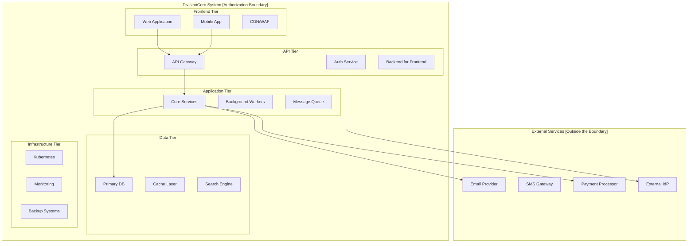
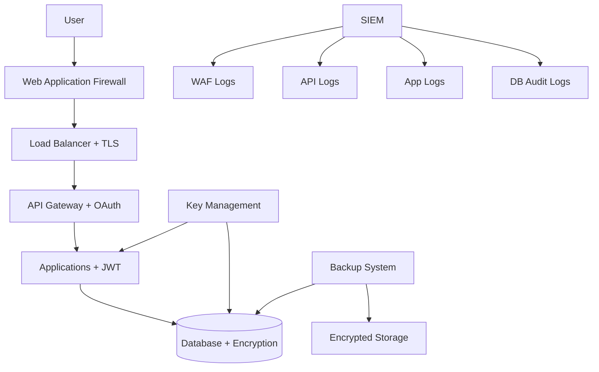
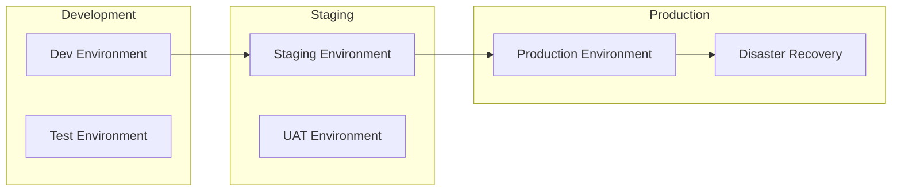
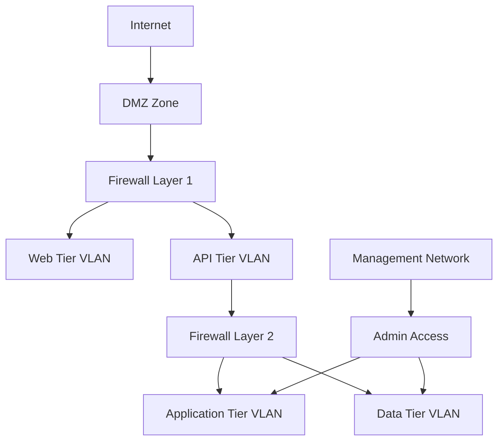
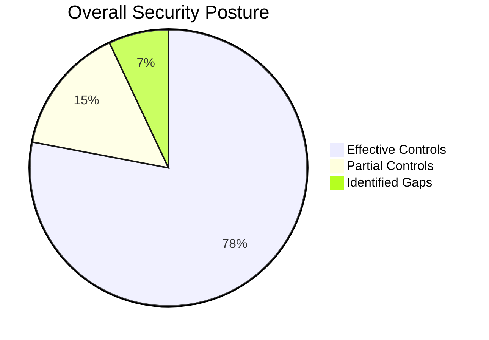

## System Information

### Identification
- **System Name**: DivisionCero SaaS Platform
- **SSP Version**: 1.0.0
- **System Type**: SaaS Multi-tenant  
- **Classification**: Confidential (Internal Use)
- **Owner**: DivisionCero Inc.
- **Custodian**: Chief Technology Officer (CTO)
- **Responsible CISO**: Chief Information Security Officer

### Overview
DivisionCero SaaS Platform is a software-as-a-service platform that provides business management solutions to corporate customers. The system processes business data from multiple organizations in a secure multi-tenant architecture.

#### Business Purpose:
- Business process management
- Advanced analytics and reporting  
- Integration with third-party systems
- APIs for external developers

### System Boundaries



### System Data

#### Types of Information Processed:
1. **Confidential**: Customer financial data, commercial contracts
2. **Internal**: Operational metrics, application logs
3. **Public**: Technical documentation, marketing material
4. **Restricted**: Employee data, intellectual property information

#### Data Volume:
- **Active data**: ~50 TB
- **Backups**: ~200 TB  
- **Monthly growth**: ~5 TB
- **User records**: 25,000+ active

## Security Architecture

### Security Model
**Principle**: Zero Trust Architecture with defense in depth

#### Security Layers:
1. **Network Security**: Firewalls, VPN, Network Segmentation
2. **Identity Security**: IAM, MFA, PAM
3. **Application Security**: WAF, API Security, Secure Coding
4. **Data Security**: Encryption, DLP, Classification
5. **Infrastructure Security**: Container Security, Hardening
6. **Monitoring**: SIEM, EDR, Threat Intelligence

### Security Data Flow



## Control Implementation by Domain

### COR - Organizational Coherence

#### COR-001: Cybersecurity Governance
**Status**: ✅ Implemented  
**Description**: Executive cybersecurity committee established

**Specific Implementation**:
- **Committee**: CEO, CTO, CISO, CFO, Head Legal
- **Meetings**: Mandatory monthly + ad hoc for incidents
- **Responsibilities**: 
  - Approval of security policies
  - Review of the cybersecurity budget
  - Response to critical incidents
- **Evidence**: Meeting minutes, documented decisions

#### COR-002: Security Framework Policy  
**Status**: ✅ Implemented  
**Description**: Organizational policy approved by the Board

**Specific Implementation**:
- **Document**: "Information Security Policy v2.1"
- **Approval**: Board of Directors (2024-01-15)
- **Review**: Mandatory annual
- **Communication**: All-hands meeting + intranet
- **Evidence**: Signed policy, training records

### ADR - Analysis, Detection and Response

#### ADR-001: Continuous Monitoring
**Status**: ✅ Implemented  
**Description**: 24/7 SIEM with ML-based detection

**Specific Implementation**:
- **Platform**: Elastic Stack + Wazuh + Custom ML
- **Coverage**: 100% of critical systems
- **SLA**: 99.9% uptime, alerts in < 5 minutes
- **Capabilities**:
  - Multi-source event correlation
  - Anomaly detection with machine learning
  - Threat intelligence integration
  - Automated playbook execution
- **Staff**: SOC analysts 24/7/365
- **Evidence**: Operational dashboards, configured alerts

#### ADR-002: Incident Response Plan
**Status**: ✅ Implemented  
**Description**: Structured response procedures

**Specific Implementation**:
- **Document**: "Incident Response Plan v1.3"
- **Classification**: 4 levels (P0-P3)
- **Escalation**: Automatic by severity
- **RTO/RPO**: P0: 4h/1h, P1: 8h/4h, P2: 24h/8h, P3: 72h/24h
- **Tools**: SOAR platform for automation
- **Training**: Quarterly drills
- **Evidence**: Runbooks, post-mortem reports

### CAP - Application Cybersecurity

#### CAP-001: Secure Development
**Status**: ✅ Implemented  
**Description**: Security-by-design in the SDLC

**Specific Implementation**:
- **Pipeline**: GitLab CI/CD with security gates
- **SAST**: SonarQube with custom rules
- **DAST**: OWASP ZAP automated scanning
- **Dependency Scanning**: Snyk integration
- **Code Review**: Mandatory security reviews
- **Training**: Secure coding bootcamp for developers
- **Evidence**: Pipeline configs, scan reports

#### CAP-002: API Management  
**Status**: ✅ Implemented  
**Description**: Complete API security framework

**Specific Implementation**:
- **Gateway**: Kong Enterprise with plugins
- **Authentication**: OAuth 2.0 + API keys hybrid
- **Rate Limiting**: Intelligent per-customer limits
- **Documentation**: OpenAPI 3.0 specs
- **Monitoring**: API analytics and health checks
- **Evidence**: API catalog, security policies

### CIF - Infrastructure Cybersecurity

#### CIF-001: System Hardening
**Status**: ✅ Implemented  
**Description**: Secure configurations according to CIS

**Specific Implementation**:
- **Baseline**: CIS Benchmarks Level 1
- **Automation**: Ansible playbooks
- **Scanning**: OpenSCAP compliance scanning
- **OS**: Ubuntu 22.04 LTS hardened
- **Containers**: Distroless base images
- **Evidence**: Compliance reports, automation scripts

#### CIF-002: Vulnerability Management
**Status**: 🔄 In Progress (POA&M 001)  
**Description**: Automated patching program

**Current Implementation**:
- **Scanning**: Tenable Nessus weekly scans
- **Prioritization**: CVSS + EPSS scoring
- **Patching**: Manual process (being automated)
- **SLA**: Critical < 72h, High < 7d, Medium < 30d
- **Gap**: Full automation missing
- **Timeline**: Complete in 12 weeks

### CIP - Identity and Endpoints

#### CIP-001: Identity Management
**Status**: ✅ Implemented  
**Description**: Robust IAM with universal MFA

**Specific Implementation**:
- **Platform**: Keycloak + Microsoft Entra ID
- **MFA**: 100% of employees (FIDO2 preferred)
- **SSO**: Integration with 25+ applications
- **Provisioning**: Automated with HR systems
- **Reviews**: Quarterly access reviews
- **Evidence**: MFA enrollment reports, access matrices

#### CIP-002: Endpoint Protection
**Status**: ✅ Implemented  
**Description**: EDR + mobile device management

**Specific Implementation**:
- **EDR**: SentinelOne on 100% of corporate laptops
- **MDM**: Microsoft Intune for BYOD
- **Policies**: Device compliance requirements
- **Encryption**: BitLocker/FileVault mandatory  
- **Remote Wipe**: Capability for lost devices
- **Evidence**: Device inventory, compliance reports

### DIA - Data and Artificial Intelligence

#### DIA-001: Data Classification
**Status**: ⚠️ Partially Implemented  
**Description**: Classification scheme defined

**Specific Implementation**:
- **Levels**: Public, Internal, Confidential, Restricted
- **Tagging**: Manual + automated discovery
- **Tools**: Microsoft Purview (being implemented)
- **Gap**: Automated enforcement missing
- **Timeline**: Complete in Q3 2024

#### DIA-002: Data Encryption
**Status**: ✅ Implemented  
**Description**: Comprehensive encryption in transit and at rest

**Specific Implementation**:
- **In Transit**: TLS 1.3 mandatory
- **At Rest**: AES-256 for databases
- **Key Management**: HashiCorp Vault
- **Rotation**: Automated quarterly rotation
- **Customer Keys**: Option for enterprise clients
- **Evidence**: Certificate inventory, encryption configs

### THP - Human Talent and Vendor Cybersecurity

#### THP-001: Security Training
**Status**: 🔄 In Progress (POA&M 002)  
**Description**: Structured awareness program

**Current Implementation**:
- **Platform**: KnowBe4 LMS
- **Content**: Role-based training tracks
- **Frequency**: Quarterly mandatory training
- **Phishing**: Monthly simulation campaigns
- **Gap**: Customized content missing
- **Timeline**: Complete in 16 weeks

#### THP-002: Third-Party Assessment
**Status**: ⏳ Pending (POA&M 003)  
**Description**: Due diligence of critical vendors

**Current Status**:
- **Process**: Ad-hoc evaluations
- **Critical Vendors**: 25 pending assessment
- **Framework**: Developing a customized SIG Lite
- **Timeline**: 24 weeks to complete

## Deployment Architecture

### Environments



#### Environment Separation:
- **Development**: Isolated networks, mock data
- **Staging**: Production-like, sanitized data
- **Production**: Full security controls, real data
- **DR**: Cross-region replica, encrypted backups

### Network and Connectivity

#### Network Segmentation:


#### Network Controls:
- **Firewalls**: Palo Alto Next-Gen with IPS
- **WAF**: Cloudflare Enterprise
- **VPN**: WireGuard for admin access
- **Zero Trust**: BeyondCorp implementation

## Continuity and Recovery Plan

### Business Continuity Objectives
- **RTO (Recovery Time Objective)**: 4 hours
- **RPO (Recovery Point Objective)**: 1 hour  
- **MTTR (Mean Time To Repair)**: 2 hours
- **Availability Target**: 99.9% (8.77 hours downtime/year)

### Backup Strategies

#### Backup Strategy:
- **Frequency**: Continuous replication + daily snapshots
- **Retention**: Daily (30d), Weekly (12w), Monthly (12m)
- **Testing**: Monthly restore tests
- **Encryption**: AES-256 with customer-managed keys
- **Geographic**: Multi-region with 3-2-1 rule

#### Disaster Recovery:
- **Primary Site**: AWS us-east-1
- **DR Site**: AWS us-west-2  
- **Replication**: Real-time for critical data
- **Failover**: Automated with manual approval
- **Testing**: Annual DR exercises

## Security Metrics

### Main KPIs

| Metric | Target | Actual | Trend |
|---------|--------|--------|-------|
| Security Incidents | < 5/month | 2/month | ↓ |
| Vulnerability Remediation | 95% in SLA | 89% | ↑ |
| MFA Adoption | 100% | 98% | ↑ |
| Training Completion | 95% | 87% | ↑ |
| Backup Success Rate | 99.9% | 99.7% | → |
| Incident Response Time | < 30 min | 22 min | ↓ |

### Executive Dashboard



## Compliance and Audit

### Regulatory Frameworks
- **GDPR**: General Data Protection Regulation
- **SOC 2 Type II**: Security, Availability, Confidentiality
- **ISO 27001**: Information Security Management (target 2025)

### Scheduled Audits
- **Internal**: Quarterly by the internal team
- **External**: Annual by an independent firm  
- **Penetration Testing**: Twice a year by specialists
- **Compliance**: Continuous with automated tools

### Current Certifications
- ✅ **SOC 2 Type II**: Valid until Dec 2024
- 🔄 **ISO 27001**: Certification in progress
- ⏳ **GDPR**: Compliance ongoing assessment

## Change Management

### Change Management Process
1. **RFC (Request for Change)**: Documented proposal
2. **Impact Assessment**: Security and business impact
3. **Approval**: CAB (Change Advisory Board) approval
4. **Implementation**: Controlled deployment
5. **Verification**: Post-change validation
6. **Documentation**: Updated in CMDB

### Emergency Changes
- **Criteria**: Security incidents, critical vulnerabilities
- **Approval**: CISO + CTO approval sufficient
- **Timeline**: Implement first, document after
- **Review**: Post-implementation review within 48h

## Continuous Improvement Plan

### 2024 Objectives
1. ✅ Implement critical controls (Q1)
2. 🔄 Automate vulnerability management (Q2)
3. ⏳ Complete data classification (Q3)  
4. ⏳ Obtain ISO 27001 certification (Q4)

### Roadmap 2025
- Implement an advanced SOAR platform
- Develop threat hunting capabilities
- Establish security metrics automation
- Expand the third-party risk program

## Contacts and Responsibilities

### Key Roles
- **System Owner**: CTO (cto@divisioncero.com)
- **CISO**: Chief Information Security Officer
- **Security Architect**: Senior Security Engineer
- **Compliance Manager**: Legal & Compliance Team

### Emergency Escalation
1. **L1**: Security Analyst (24/7 SOC)
2. **L2**: Senior Security Engineer  
3. **L3**: CISO + CTO
4. **Executive**: CEO + Board (for major incidents)

## Support Tools

### OSCAL Validators

To validate OSCAL documents generated from Kudo:

```bash
# Install the NIST OSCAL tools
npm install -g @nist/oscal-cli

# Validate the catalog
oscal-cli validate --schema=catalog kudo-catalog.json

# Validate the SSP
oscal-cli validate --schema=ssp system-security-plan.json
```

---

*System Security Plan v1.0 - Document generated according to OSCAL standards*  
*Sistema: DivisionCero SaaS Platform | Effective since: 2024-01-01 | Next review: 2024-12-31*

