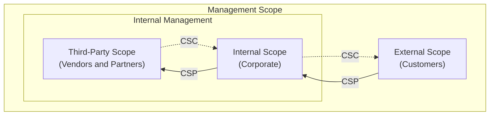

import { Step, Steps } from 'fumadocs-ui/components/steps';

## Organizational Roles

Kudo has two organizational roles

<Steps>
<Step>

### CSP (Cloud Service Provider)

</Step>

<Step>

### CSC (Cloud Service Customer)

</Step>
</Steps>

## Management Scopes

Kudo has three management scopes:

<Steps>
<Step>

### Internal Scope (Corporate)

</Step>

<Step>

### Third-Party Scope (Vendors and Partners); also Internal.

</Step>

<Step>

### External Scope (Customers)

</Step>
</Steps>

## Ecosystem Diagram

