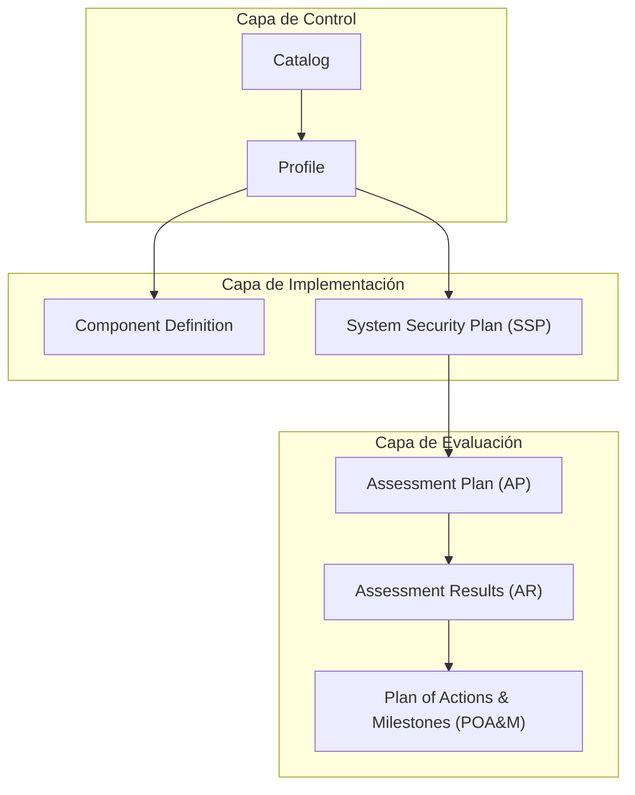

import { Database, Settings2, Boxes, ShieldCheck, ClipboardList, ClipboardCheck, ListChecks, GitCompareArrows } from 'lucide-react';
import { Accordion, Accordions } from 'fumadocs-ui/components/accordion';

## Framework Kudo

| Elemento     | Cantidad |
| ------------ | -------- |
| Dominios     | 8        |
| Controles    | 36       |
| Requisitos   | 503      |

## ¿Qué es OSCAL?

OSCAL (Open Security Controls Assessment Language) es un conjunto de formatos desarrollado por NIST (National Institute of Standards and Technology) que estandariza la expresión, evaluación e intercambio de información sobre controles de seguridad de sistemas de información.

## Formatos OSCAL

OSCAL permite el tratamiento de tres formatos: **json**, **xml** y **yaml**.

Adicionalmente, con Kudo generamos la exportación en **toon** (formato compacto pensado para modelos de lenguaje).

Los **8 modelos** están publicados en la revisión 1 en los cuatro formatos y validan contra el esquema oficial **OSCAL 1.2.3** de NIST. El JSON es la fuente de verdad; el XML se produce con el conversor oficial de NIST.

| Capa | Modelo | Archivo |
| ---- | ------ | ------- |
| Control | Catalog | `kudo-catalog` |
| Control | Profile | `kudo-profile` |
| Implementación | Component Definition | `kudo-component-definition` |
| Implementación | System Security Plan | `kudo-ssp` |
| Evaluación | Assessment Plan | `kudo-assessment-plan` |
| Evaluación | Assessment Results | `kudo-assessment-results` |
| Evaluación | Plan of Action and Milestones | `kudo-poam` |
| Correlación | Mapping | `kudo-mapping` |

## Integración Kudo-OSCAL

El framework Kudo está diseñado para ser compatible con OSCAL, proporcionando una implementación práctica de controles de seguridad expresada en los 7 componentes principales del modelo OSCAL y en el modelo de correlación (Mapping):

<Cards>
  <Card href="/framework/oscal/catalog" icon={<Database />} title="Catalog">
    Catálogo de controles de seguridad del framework Kudo estructurado según modelo OSCAL
  </Card>
  <Card href="/framework/oscal/profile" icon={<Settings2 />} title="Profile">
    Línea base que selecciona los controles del catálogo Kudo aplicables a tu organización
  </Card>
  <Card href="/framework/oscal/component-definition" icon={<Boxes />} title="Component Definition">
    Documentos del SGX (políticas, procedimientos y plantillas) y los controles que implementan
  </Card>
  <Card href="/framework/oscal/ssp-system-security-plan" icon={<ShieldCheck />} title="System Security Plan (SSP)">
    Plan integral de seguridad del sistema que documenta la implementación de controles según framework Kudo
  </Card>
  <Card href="/framework/oscal/ap-assessment-plan" icon={<ClipboardList />} title="Assessment Plan (AP)">
    Plan de evaluación de controles de seguridad basado en OSCAL para validar la implementación de controles Kudo
  </Card>
  <Card href="/framework/oscal/ar-assessment-results" icon={<ClipboardCheck />} title="Assessment Results (AR)">
    Resultados de la evaluación de controles de seguridad Kudo documentados según estándares OSCAL
  </Card>
  <Card href="/framework/oscal/poam-plan-of-actions-and-milestones" icon={<ListChecks />} title="Plan of Actions & Milestones (POA&M)">
    Plan de acciones correctivas y cronograma para remediar deficiencias identificadas en controles de seguridad
  </Card>
  <Card href="/framework/oscal/mapping" icon={<GitCompareArrows />} title="Mapping">
    Correlación de ISO 27001, NIST CSF, CIS Controls, SOC 2, PCI DSS, CSA CCM y CSA AICM con Kudo
  </Card>
</Cards>

## Referencia

La adaptación de Kudo sobre OSCAL es un proyecto colaborativo. Para contribuir:

1. Consulta nuestro [repositorio en GitHub](https://github.com/PetterVargas/divisioncero.com/tree/main/content/kudo/framework/oscal)
2. Revisa los [estándares OSCAL de NIST](https://pages.nist.gov/OSCAL/)
3. Regenera y valida los modelos con `pnpm kudo:oscal` y `pnpm kudo:oscal:xml`