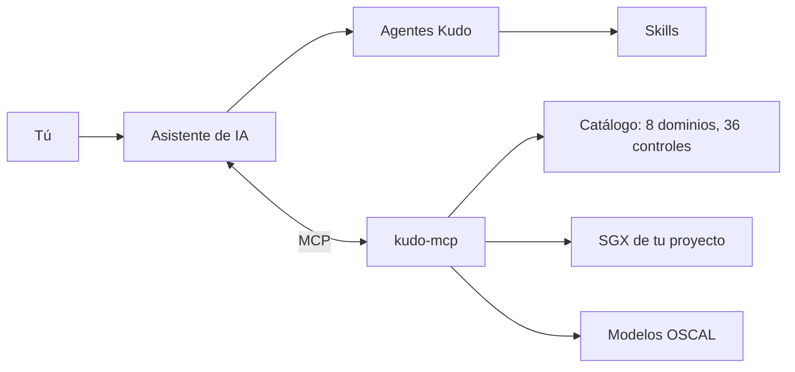

import { Server, Bot, Sparkles } from 'lucide-react';

Kudo no solo se lee: también se puede **trabajar con IA**. Además del sitio, Kudo incluye tres piezas para que tu asistente (Claude Code, Cursor, VS Code, Codex y otros) entienda el framework y ayude a implementarlo con tus propios documentos.

<Cards>
  <Card icon={<Server />} title="Servidor MCP" href="#servidor-mcp">
    Da acceso a los 36 controles, a las políticas de tu proyecto y a los modelos OSCAL.
  </Card>
  <Card icon={<Bot />} title="Agentes" href="#agentes">
    8 especialistas de ciberseguridad, uno por área de responsabilidad.
  </Card>
  <Card icon={<Sparkles />} title="Skills" href="#skills">
    16 instrucciones reutilizables que los agentes aplican en cada tarea.
  </Card>
</Cards>



## Servidor MCP

El [Model Context Protocol](https://modelcontextprotocol.io) (MCP) es el estándar abierto con el que los asistentes de IA se conectan a fuentes de datos y herramientas. El paquete [`@divisioncero/kudo-mcp`](https://www.npmjs.com/package/@divisioncero/kudo-mcp) se ejecuta **en tu equipo**, dentro de la carpeta de tu proyecto, y lee las políticas que tu organización adaptó.

```bash
claude mcp add kudo -- npx -y @divisioncero/kudo-mcp@latest
```

| Herramienta | Para qué sirve |
| ----------- | -------------- |
| `kudo_listar_dominios` | Ver los 8 dominios y sus controles |
| `kudo_obtener_control` | Enunciado, requisitos y documentos de un control (`cip-2`) |
| `kudo_buscar` | Buscar en controles, requisitos y documentos |
| `kudo_listar_documentos` / `kudo_obtener_documento` | Leer las políticas y procedimientos del proyecto |
| `kudo_cobertura` | Detectar controles sin documento (brechas) |
| `kudo_obtener_modelo_oscal` | Obtener cualquiera de los 8 modelos [OSCAL](/framework/oscal) |
| `kudo_crear_item_poam` | Convertir un hallazgo en un ítem de POA&M OSCAL |
| `kudo_listar_agentes` / `kudo_obtener_agente` / `kudo_obtener_skill` | Consultar agentes y skills |

También expone **recursos** (`kudo://oscal/{modelo}`, `kudo://documentos/{slug}`, `kudo://skills/{nombre}`) y un **prompt por agente**. Es de solo lectura: no modifica archivos.

## Agentes

Cada agente es un rol especializado con instrucciones, límites y las skills que necesita. En Claude Code se instalan en `.claude/agents/`; en otros clientes están disponibles como prompts del MCP.

| Agente | Dominios | Úsalo para | Skills |
| ------ | -------- | ---------- | ------ |
| `kudo-ciso` | COR | Priorizar el programa, riesgos, comité y cumplimiento | gestión de riesgos, mapeo de cumplimiento |
| `kudo-auditor` | COR | Auditorías internas, hallazgos y POA&M en OSCAL | auditoría interna, OSCAL |
| `kudo-redactor-sgx` | Todos | Crear, adaptar y revisar políticas y procedimientos | redacción de políticas |
| `kudo-respuesta-incidentes` | ADR | Incidentes en curso, ejercicios de mesa y vulnerabilidades | respuesta a incidentes, gestión de vulnerabilidades |
| `kudo-appsec` | CAP, CCN | Revisión de código, APIs, CI/CD y cambios | desarrollo seguro, gestión de cambios |
| `kudo-arquitecto-nube` | CIF, CIP | Nube, infraestructura como código, IdP, MFA y accesos | seguridad en la nube, identidad y accesos |
| `kudo-privacidad-ia` | DIA | Datos personales, clasificación, retención y gobierno de IA | protección de datos, gobierno de IA |
| `kudo-personas-y-proveedores` | THP | Concienciación, phishing simulado y proveedores | concienciación, riesgo de proveedores |

Todos los agentes comparten la skill base `kudo-framework`, que les enseña la estructura de Kudo y cómo citar controles y documentos.

## Skills

Las skills siguen el formato abierto [Agent Skills](https://agentskills.io): una carpeta con un `SKILL.md` que el asistente carga cuando la tarea lo requiere. Están en el repositorio, en [`kudo/skills`](https://github.com/PetterVargas/divisioncero.com/tree/main/kudo/skills), y se instalan en cualquier asistente compatible con:

```bash
npx skills add PetterVargas/divisioncero.com
```

| Skill | Qué aporta |
| ----- | ---------- |
| `kudo-framework` | Estructura de Kudo, herramientas MCP y reglas para citar fuentes |
| `kudo-gestion-de-riesgos` | Matriz 3×3, apetito de riesgo y registro de riesgos |
| `kudo-mapeo-de-cumplimiento` | Matriz de cumplimiento contra leyes y estándares |
| `kudo-auditoria-interna` | Programa, listas de verificación y redacción de hallazgos |
| `kudo-oscal` | Crear, adaptar y validar los modelos OSCAL |
| `kudo-redaccion-de-politicas` | Estructura, frontmatter y criterios de calidad del SGX |
| `kudo-respuesta-a-incidentes` | Triage, contención, notificación y lecciones aprendidas |
| `kudo-gestion-de-vulnerabilidades` | Priorización y plazos de remediación |
| `kudo-desarrollo-seguro` | Revisión de código, modelado de amenazas, pipeline y APIs |
| `kudo-gestion-de-cambios` | Clasificación, pruebas y plan de rollback |
| `kudo-seguridad-en-la-nube` | Lista de verificación de cuentas de nube e IaC |
| `kudo-identidad-y-accesos` | MFA, contraseñas, Joiner-Mover-Leaver y revisiones de acceso |
| `kudo-proteccion-de-datos` | Clasificación, registro de tratamientos y legislación LatAm |
| `kudo-gobierno-de-ia` | Evaluación de herramientas, agentes y servidores MCP |
| `kudo-concienciacion` | Plan anual, campañas de phishing y mensajes |
| `kudo-riesgo-de-proveedores` | Clasificación, cuestionarios y revisión de SOC 2 / ISO 27001 |

## Empezar

Si creas tu sitio con `pnpm create @divisioncero/kudo-app`, el proyecto ya incluye el MCP, los agentes y las skills. Sigue la guía de [Aprovisionamiento - Trabajar con IA](https://divisioncero.com/kudo/sgx/aprovisionamiento/trabajar-con-ia).

<Callout type="warn" title="La IA asiste, no decide">
  Los agentes aceleran el trabajo, pero las decisiones de riesgo, la aprobación de políticas y las notificaciones legales siguen siendo responsabilidad de las personas designadas en tu organización. Úsalos conforme a la [Política de Uso Aceptable de Inteligencia Artificial](/sgx/politicas-y-procedimientos/politica-de-uso-aceptable-de-inteligencia-artificial).
</Callout>
